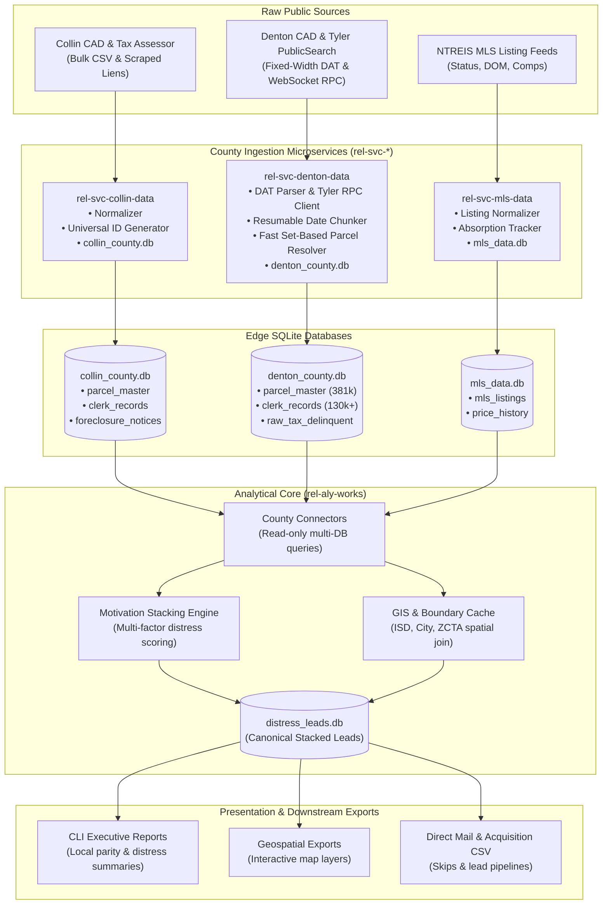

# Architecture & System Design

This document details the architectural boundaries, pipeline stages, storage paradigms, and design decisions for the `rel-*` autonomous real estate intelligence platform.

---

## 1. Architectural Philosophy

The architecture adheres to three core tenets:

1. **Decoupled Edge Microservices (`rel-svc-*`):** Each county has disparate open-records formats, differing portal vendors (Tyler Technologies PublicSearch, Kofile, Granicus, TexasFile), distinct CAD export layouts (Denton fixed-width `.DAT`, Collin pipe-delimited CSV), and varying update cadences. Extractors are isolated into self-contained microservices.
2. **Unified Edge Persistence (SQLite):** Each service persists directly to an embedded SQLite database using WAL (`Write-Ahead Logging`) mode. This provides zero-network-overhead reads/writes, trivial backups, and no external daemon (e.g. Postgres) maintenance.
3. **Downstream Intelligence Core (`rel-aly-works`):** Analytical modeling, GIS enrichment, ISD parity metrics, and motivation stacking are decoupled from ingestion. The analytical core treats county databases as read-only upstream data sources.

---

## 2. Complete Data Flow Diagram



---

## 3. Ingestion Lifecycle in `rel-svc-*`

Every county ingestion microservice implements four sequential lifecycle stages:

```
┌─────────────┐       ┌───────────────┐       ┌────────────────┐       ┌─────────────────┐
│ 1. EXTRACT  │ ────> │ 2. NORMALIZE  │ ────> │ 3. RESOLVE     │ ────> │ 4. PERSIST      │
│ (Raw source)│       │ (Data Contract│       │ (Universal ID) │       │ (SQLite WAL)    │
└─────────────┘       └───────────────┘       └────────────────┘       └─────────────────┘
```

1. **Extract:** 
   - Downloads bulk rolls (e.g. Denton CAD annual `.DAT` archives, Collin bulk parcels).
   - Or runs incremental delta streaming (e.g. Tyler PublicSearch WebSocket RPC for clerk filings, county tax rolls).
2. **Normalize:**
   - Maps vendor-specific columns to canonical fields (`UniversalID`, `situs_address`, `doc_type`, etc.).
   - Parses dates into strict `YYYY-MM-DD` strings.
   - Cleans situs street addresses using standard USPS uppercase abbreviations (`ST`, `AVE`, `RD`, `BLVD`, `DR`, `LN`).
3. **Resolve:**
   - Evaluates recorded deeds, deeds of trust, or liens against `parcel_master`.
   - Uses set-based indexed SQL queries to link instrument numbers and grantee names to `universal_id`.
4. **Persist & Checkpoint:**
   - Inserts or replaces into canonical tables (`clerk_records`, `parcel_master`).
   - Updates `raw_clerk_chunks` with `status = 'COMPLETED'` and timestamp to prevent duplicate work.

---

## 4. Downstream Intelligence Lifecycle in `rel-aly-works`

1. **Cross-County Ingestion Connector:**
   - Points read-only SQLite connections to `../rel-svc-collin-data/data/collin_county.db` and `../rel-svc-denton-data/data/denton_county.db`.
   - Queries `parcel_master`, `clerk_records`, and tax tables.
2. **Motivation Stacking & Scoring:**
   - Detects compound distress signals per property:
     - Probate / Heirship filing (`is_probate = 1`)
     - Involuntary HOA Assessment Lien (`is_hoa_lien = 1`)
     - Delinquent County Ad Valorem Taxes (`is_tax_delinquent = 1`)
     - Lis Pendens / Foreclosure Notice (`is_foreclosure = 1`)
     - Out-of-state / Absentee Owner + Non-homestead (`is_absentee = 1`)
   - Computes weighted motivation scores and stacks distress counts.
3. **Spatial & ISD Aggregation:**
   - Groups properties into Independent School Districts (e.g., Frisco ISD, Plano ISD, Denton ISD, Lewisville ISD) and Zip Codes.
   - Computes median market values, distress densities, and year-over-year turnover rates.
4. **Export Generation:**
   - Emits structured outputs (`distress_leads.csv`, `localized_intelligence.json`, `distress_layers.geojson`).

---

## 5. Technology Standards

| Category | Standard | Rationale |
| :--- | :--- | :--- |
| **Language** | Python 3.10+ | Robust type hinting, modern `asyncio`, universal library support. |
| **Package Management** | `uv` | $10-100\times$ faster than standard `pip`, deterministic lockfiles (`uv.lock`). |
| **Database Engine** | SQLite 3 (WAL mode) | Embedded, zero external process dependencies, instant file-level transfers. |
| **Code Formatting** | `ruff` | Blazing-fast Rust-based linter and formatter (line-length 100). |
| **Testing** | `pytest` | Standardized unit and integration test runner. |
| **Deployment** | Git Pull over SSH Deploy Keys | Automated, clean, reproducible deployments with zero file divergence. |
